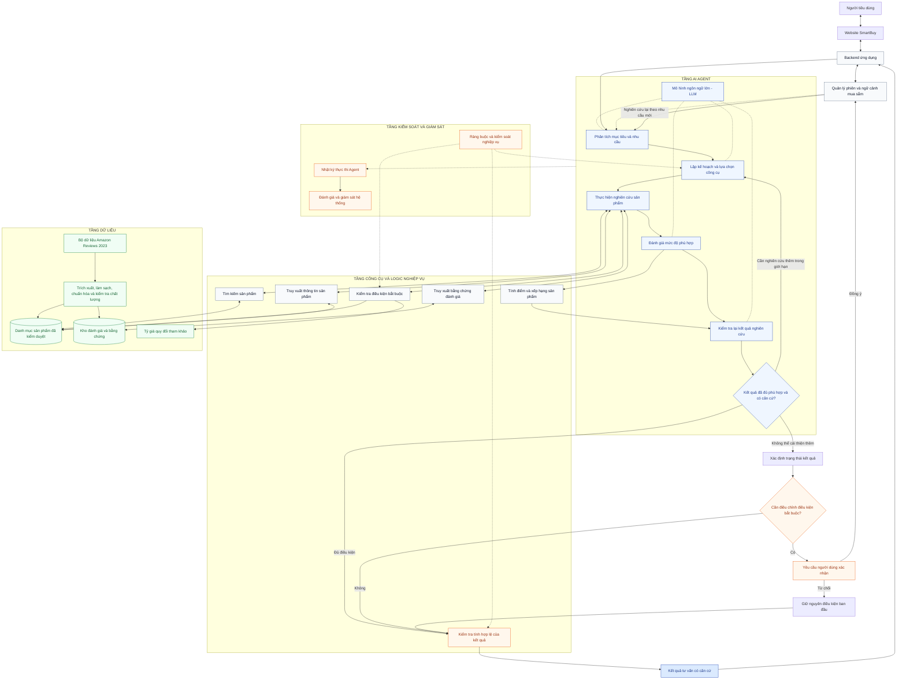

# AI SPEC — [Tên lát cắt] · Nhóm [tên nhóm] · Phòng [XXX] · Zone [X]

> Mốc nộp: §7 chốt chuẩn "đạt" tại **CP2 19:30 Thứ Sáu 27/11** · §0–§7 nộp **CP3 10:00 Thứ Bảy 28/11** · đủ §0–§10 **CP4 14:30 Thứ Bảy 28/11** · §10 changelog ghi tiếp đến **23:59 Thứ Bảy 28/11**.
> Đầu mỗi mục ghi bước guide (`02-guide.md` trong repo đề) chỉ cách điền. Mỗi mục ngắn, có số và nguồn; chi tiết để ở file được trỏ tới. Xoá dòng hướng dẫn trong ngoặc vuông khi điền xong.

Track: [ ] A · [ ] B · [ ] C · [ ] D · [ ] E — bài toán: [đề gợi ý trong file track, hoặc bài toán nhóm tự mở rộng] __
Data BTC cấp đã dùng (nếu có — không commit nguyên file): __

## §0. Hiện tại việc này diễn ra thế nào *(guide 1.1)*

Luồng hiện tại được tổng hợp từ lời kể trong [P1](evidence/interviews/P1.md), [P2](evidence/interviews/P2.md), [P3](evidence/interviews/P3.md); chưa có ảnh chụp thao tác hoặc quan sát trực tiếp:

1. Phát sinh nhu cầu và xác định mục đích: P1 thay tai nghe hỏng; P3 mua tai nghe Bluetooth để học và nghe nhạc. P2/P3 xác định tầm giá trước khi chọn.
2. Tìm các mẫu trên sàn hoặc qua nội dung review. P1/P3 dùng Shopee và TikTok; P2 tìm theo phân khúc giá và nhu cầu.
3. Đọc review, xem video, so sánh giá và tính năng. P1 quan tâm âm thanh, chống ồn, pin; P3 gặp hai mẫu giá gần nhau nhưng review âm thanh và pin trái chiều.
4. Tìm thêm căn cứ khi chưa quyết định được: P1 dùng AI so sánh, P2 tìm shop của KOL mình tin tưởng, P3 xem YouTube và bình luận người mua.
5. Chọn sản phẩm hoặc tiếp tục cân nhắc. P2 đã mua nhưng chưa ưng giá; P3 cho biết tìm thêm review giúp dễ quyết định hơn. P1 chưa ghi nhận mẫu được chọn hoặc giao dịch hoàn tất.

Công cụ/AI đang dùng: Shopee, TikTok, YouTube và AI so sánh sản phẩm theo lời kể trên; P1 không nêu tên công cụ AI. Chưa kiểm trực tiếp tính năng hoặc hiệu quả của từng nền tảng. Cách làm hiện tại vẫn hữu ích, nhưng người mua phải tự kết hợp thông tin từ nhiều nơi.

## §1. Người dùng & bằng chứng *(guide 1.1, 1.2)*

- **Người dùng chính:** người mua tự nghiên cứu và chọn tai nghe, chuột hoặc bàn phím cho nhu cầu cá nhân, có giới hạn chi tiêu. Nhóm tiếp cận ban đầu là sinh viên mua tai nghe; cả ba người phỏng vấn thuộc nhóm này. Khảo sát mở rộng sang người tìm chuột và bàn phím, chưa xác minh nghề nghiệp toàn mẫu.
- **Việc họ cố làm xong:** chọn một sản phẩm phù hợp nhu cầu và ngân sách sau khi đối chiếu thông số, giá và đánh giá, trước khi tự quyết định mua.
- **Cách giải hiện tại và hạn chế:** đọc review/video, so sánh giá, hỏi nguồn tin cậy hoặc dùng AI. P1 bị ngợp thông tin; P2 khó cân đối chất lượng và giá; P3 phải tìm thêm nhiều nguồn để xử lý đánh giá trái chiều. P3 tiếp tục vì cách này khá hiệu quả; lý do duy trì cách làm của P1/P2 chưa được hỏi rõ.
- **Pain:** người mua đang nghiên cứu tai nghe, chuột hoặc bàn phím phải tự tổng hợp nhiều thông tin và review khó đối chiếu, dẫn đến tốn công lựa chọn và còn phân vân về độ phù hợp hoặc giá.

| Bằng chứng | Số chính / tình huống | Ý nghĩa và giới hạn |
|---|---|---|
| Phỏng vấn | 3/3 kể được khó khăn; P1 ước lượng 1–2 giờ, P2 quá trình kéo dài 2 tuần, P3 2–3 ngày × 30–60 phút/ngày | Hỗ trợ pain khi chọn tai nghe; không cộng các thời lượng khác đơn vị hoặc coi toàn bộ là lãng phí. Chưa hỏi tần suất pain trong tháng. |
| Khảo sát | 21 phản hồi, 20 đúng trải nghiệm mục tiêu: 8 tai nghe, 6 chuột, 6 bàn phím; 16/20 khó với review, 14/20 khó thu hẹp, 12/20 khó so sánh, 10/20 khó cân đối ngân sách | Câu nhiều lựa chọn, không cộng các nhóm pain. Mẫu tự chọn; chưa kiểm trùng người hoặc xác nhận toàn bộ ngoài nhóm. |
| Ảnh hưởng tự báo cáo | 14/20 chọn ảnh hưởng mức 4–5; 6/20 còn phân vân, 6/20 tiếp tục tìm/trì hoãn, 2/20 từ bỏ mua | Cho thấy hệ quả trong mẫu, chưa chứng minh pain là nguyên nhân duy nhất. |
| Đào data | 13/181 review (7,18%) có nhãn pain, sau khi loại 19/200 review ngoài scope; đã đếm lại bằng `python evidence/count_pain.py` | Đơn vị là review, không phải người; nhãn đã được người dùng duyệt, mẫu prefix chưa đại diện thị trường. |

Chi tiết và nguồn truy vết: [evidence/summary.md](evidence/summary.md), [data-mining.md](evidence/data-mining.md). Kết luận: có căn cứ ưu tiên hỗ trợ thu hẹp và so sánh lựa chọn; chưa chứng minh SmartBuy tiết kiệm bao nhiêu thời gian hoặc tốt hơn các cách hiện tại.

## §2. Impact & quyết định chọn *(guide 1.3)*

Ba hướng dưới đây là phương án phân tích ở thời điểm hoàn thiện spec, không phải nhật ký quyết định đã được ghi trước khi khảo sát. Độ phổ biến lấy từ 20 phiếu đúng trải nghiệm mục tiêu; các nhóm có thể trùng nhau. Đánh giá khả thi là nhận định BA, cần Dev xác nhận khi triển khai.

| Hướng | Bao nhiêu người gặp | Bao nhiêu lần / tháng | Mỗi lần tốn gì | Impact / tháng | Làm kịp không | Chọn? |
|---|---|---|---|---|---|---|
| Thu hẹp tối đa 3 lựa chọn, so sánh theo nhu cầu/ngân sách và bằng chứng review | 16/20 khó với review; 14/20 khó thu hẹp; 12/20 khó so sánh | Chưa đo tần suất pain; kịch bản 1 phiên/người/tháng *(tự ước tính)* | P1: cả quá trình 60–120 phút; P3: 30–60 phút/ngày trong 2–3 ngày; chưa đo riêng bước khó | Kịch bản 100 người × 1 phiên × 15 phút tiết kiệm = 1.500 phút/tháng *(tự ước tính)* | Có thể làm bản hẹp với catalog cố định và nguồn truy vết; còn phụ thuộc dữ liệu/model thật | Chọn |
| Giải thích thuật ngữ và thông số đơn thuần | 8/20 chọn khó hiểu thông số; P1 nêu thông số rườm rà | Chưa đo | Chưa đo riêng thời gian giải nghĩa | Chưa đủ căn cứ tính riêng | Phạm vi nhỏ, nhưng không giải quyết đầy đủ review trái chiều hoặc thu hẹp lựa chọn | Không chọn làm hướng chính; giữ giải thích trong tư vấn |
| So sánh giá hiện tại giữa các shop, theo dõi khuyến mãi | 10/20 khó cân đối tính năng/ngân sách; P2 chưa ưng giá — chỉ hỗ trợ gián tiếp nhu cầu theo dõi giá | Chưa đo | P2 mất 2 tuần theo lịch để chọn; không biết thời gian thực so giá | Chưa đủ căn cứ tính riêng | Cần nguồn giá/tồn kho mới; catalog Amazon lịch sử không đáp ứng cam kết giá hiện tại | Loại khỏi lát cắt |

- **Impact / tháng, kịch bản cơ sở:** 100 người dùng hoạt động × 1 phiên/người/tháng × 15 phút giảm được/phiên = **1.500 phút = 25 giờ/tháng**. Cả ba thừa số là *tự ước tính để lập kế hoạch*, không suy ra từ 20 phiếu hay từ thời gian P1/P3. Chưa phải kết quả đo hoặc quy mô người dùng đã có.
- **Độ nhạy:** giữ 100 người và 1 phiên/tháng, nếu tiết kiệm 0/5/15/30 phút mỗi phiên thì impact là 0/500/1.500/3.000 phút/tháng *(tự ước tính)*. Phải tính cả thời gian người dùng kiểm tra nguồn và sửa yêu cầu; lợi ích có thể bằng 0 hoặc âm nếu công cụ khiến họ mất thêm thời gian.
- **Cách kiểm impact:** giao cùng loại nhiệm vụ và ngân sách cho người thử, đo thời gian chủ động từ lúc bắt đầu đến khi có lựa chọn đủ căn cứ, so sánh cách hiện tại với SmartBuy. Ghi thêm việc vi phạm điều kiện, độ đúng nguồn và mức tự tin; chỉ báo cáo tiết kiệm khi chất lượng lựa chọn đáp ứng tiêu chí. Chưa có phiên đo này.
- **Hướng đã loại:** giải nghĩa thuật ngữ độc lập chưa bao phủ pain chính; theo dõi giá hiện tại cần dữ liệu ngoài phạm vi. Quyết định ưu tiên tổng hợp review và so sánh gắn với nhu cầu dựa trên 16/20, 14/20 và tình huống P1/P3, không dựa trên giả định mọi người đều thiếu kiến thức kỹ thuật.
- **Persona cho §8:** người tìm ít 1 phiên/tháng, người đang cân nhắc 2 phiên/tháng, người tìm nhiều 4 phiên/tháng — đều *tự ước tính*, mỗi phiên là một lần nghiên cứu chứ không phải một lần mua. Chưa chốt tỷ trọng persona hoặc số lượt hỏi/phiên; cần đối chiếu câu 4 khảo sát và dữ liệu thử nghiệm trước khi đưa vào mô phỏng. Các số này chưa phải cấu hình trong `cost/personas.yaml`.

## §3. Giải pháp tương tự *(guide 2.1)*

So sánh dựa trên cách người tham gia đã sử dụng, không phải kiểm thử tính năng hiện hành của các sản phẩm. Khác biệt SmartBuy dưới đây là mục tiêu thiết kế, chưa là kết quả chứng minh ưu thế.

| Cách giải quyết gần giống | Điều đáng học | Hạn chế cần tránh | SmartBuy dự kiến khác gì | Căn cứ |
|---|---|---|---|---|
| Tự tìm trên Shopee, đọc đánh giá và so giá | Bám nhu cầu mua cụ thể, nhìn giá cùng phản hồi người mua | Để người mua tự nối thông tin giữa nhiều mẫu và nhiều nơi | Thu hẹp tối đa 3 mẫu trong catalog, trình bày cùng tiêu chí và chỉ rõ nguồn; không cam kết giá Shopee hiện tại | P1 Q01/Q02; P3 Q01–Q03 |
| Video review TikTok/YouTube | Cách diễn đạt trải nghiệm giúp người mua hiểu sản phẩm | Bỏ qua ý kiến trái chiều hoặc để người mua xem nhiều nguồn mà chưa có so sánh chung | Tổng hợp ưu/nhược điểm theo nhu cầu và nêu mâu thuẫn/thiếu bằng chứng; không tự thu thập video ngoài Amazon | P3 Q03/Q05; P1 Q01 |
| Shop của KOL được người mua tin tưởng | Có điểm tựa để ra quyết định | Coi uy tín nguồn tư vấn là bằng chứng sản phẩm phù hợp mọi ngân sách | Kiểm điều kiện bắt buộc trước khi đề xuất và nêu đánh đổi về giá/chất lượng | P2 Q03/Q05; P2 vẫn chưa ưng giá |
| Công cụ AI so sánh mà P1 đang dùng (chưa biết tên) | Nhận nhu cầu bằng ngôn ngữ tự nhiên và hỗ trợ so sánh | Tuyên bố SmartBuy tốt hơn khi chưa đo hiệu quả công cụ hiện tại | Giới hạn ba ngành hàng, yêu cầu nguồn catalog/review truy vết và kiểm điều kiện bắt buộc; cần so sánh thực nghiệm để xác nhận lợi ích | P1 Q05; chưa ghi nhận mức hiệu quả hoặc hạn chế của công cụ đó |

## §4. Thiết kế *(guide 2.2, 3.2)*
- **Lát cắt MỘT CÂU** (1 người dùng · 1 việc · 1 quyết định AI · 1 kết quả): Người tiêu dùng phổ thông cần lựa chọn tai nghe, chuột hoặc bàn phím được AI Agent nghiên cứu và quyết định xếp hạng tối đa 3 sản phẩm phù hợp nhất với nhu cầu và ngân sách, kèm lý do đề xuất, ưu điểm, hạn chế và bằng chứng từ Amazon Reviews 2023.
- Không làm (≥3 điều):
  Không hỗ trợ ngành hàng ngoài tai nghe, chuột và bàn phím.
  Không thực hiện giao dịch, đặt hàng, thanh toán và vận chuyển.
  Không cập nhật giá, khuyến mãi và tồn kho theo thời gian thực.
  Không thu thập dữ liệu sản phẩm và review từ nguồn ngoài Amazon Reviews 2023.
  Không tự ý thay đổi ngân sách hoặc điều kiện bắt buộc khi chưa được người dùng đồng ý.
  Không đưa ra nhận định, thông số hoặc đánh giá sản phẩm thiếu bằng chứng.
  Không xây dựng hệ thống quản lý người bán và tài khoản khách hàng dài hạn.
- **Sơ đồ** (ảnh / Mermaid / draw.io):

- **Hình dạng:** [ ] workflow cố định · [ ] một agent · [ ] nhiều agent — 2 dòng lý do, và vì sao **không** chọn hình dạng phức tạp hơn:
- **AI dựa vào đâu** — mỗi công cụ (khớp `codebase/tools.py`):

  | Công cụ | Input | Output | Tác động ra ngoài? |
  |---|---|---|---|
  |  |  |  |  |

- **Mức tự động:** [ ] AI gợi ý, người quyết · [ ] AI tự làm khi chắc, chuyển người khi không · [ ] AI tự làm — lý do (sai thì ai chịu gì, sửa đắt hay rẻ):
- **Chỗ chặn rủi ro** (rủi ro lớn nhất của lát cắt bị chặn ở đâu, bằng gì):
- **Chỗ người duyệt** (việc AI không được tự làm):
- **Nguyên tắc thiết kế** (≥3, bắt buộc G10):

  | Nguyên tắc | Chỗ cụ thể trên sơ đồ / trong bản chạy thử |
  |---|---|
  | G10 — thu hẹp phạm vi khi không chắc |  |
  |  |  |
  |  |  |

- Phần nào còn giả (công cụ trả dữ liệu giả, model chế độ giả…) — ghi rõ, không giả làm thật:

## §5. Chỗ khó — 4 lớp + ≥6 kịch bản + 2 tấn công *(guide 2.3)*

| Kịch bản | Lớp (1–4) | Hành vi mong muốn (nói gì, hiện gì, cho làm gì tiếp) | Câu thử |
|---|---|---|---|
|  |  |  |  |
| *(tấn công)* |  |  |  |
| *(tấn công)* |  |  |  |

(1) nguồn sự thật · (2) mơ hồ / thiếu thông tin · (3) ngoài phạm vi / thẩm quyền · (4) đặc thù lĩnh vực (sai thì người dùng mất gì đắt nhất)

## §6. Bốn đường đi của trải nghiệm
- Mọi thứ suôn sẻ: · Không chắc (lớp 2): · Không có căn cứ (lớp 1): · Người dùng sửa:
- Bị đòi ngoài phạm vi (lớp 3): · Trường hợp đặc thù lĩnh vực (lớp 4):

## §7. Đánh giá & chuẩn "đạt" *(guide 2.4, 4.1)*
- Data card: `data/DATA_CARD.md` · bộ câu thử: `eval/benchmark.csv` — 24 câu (thuong 12 · kho 10 · tu_choi 2) · metric: `eval/metric_spec.yaml` (5 metric)
- **Chuẩn "đạt"** (chốt **trước 19:30 Thứ Sáu 27/11**, giữ nguyên đến 23:59 Thứ Bảy 28/11): "Đạt khi ≥ 80% câu qua, và 100% câu kiểm thử ràng buộc bắt buộc, từ chối đúng phạm vi phải đạt; không đề xuất sản phẩm vi phạm ngân sách hoặc điều kiện bắt buộc, không bịa thông tin sản phẩm và review, mọi nhận định thực tế về sản phẩm đều có bằng chứng truy xuất được từ Amazon Reviews 2023. "
- Kết quả: lượt 1 15/24 (62%) · lượt 2 __/__ (__%) — run ID: run-1@20261128-075128 / __ → chi tiết `eval/report.md`, hồ sơ `eval/README.md`

## §8. Chi phí khi dùng thật *(guide 4.2)*
- Persona + giá: `cost/personas.yaml` · lượt mô phỏng: `cost/simulate-__.csv` (__ phiên)
- Chi phí / task thành công: __ (model __) · __ (model __)
- Chi phí / tháng ở quy mô thật: thấp __ · cơ sở __ · cao __ → chi tiết `cost/cost-estimate.md`
- So với impact / người / tháng (§2): đáng làm không, vì sao:

## §9. Rủi ro & an toàn
- Dữ liệu: đã ẩn danh gì, không thu gì, không đưa gì vào model gói miễn phí:
- AI **không được** làm gì kể cả khi người dùng yêu cầu:
- Ai có thể bị hại nếu AI sai, và nhóm chặn thế nào:

## §10. Phân công & changelog
- Phân công có tên (theo chặng, chia cặp — guide "Cách chia việc"): __
- Dùng AI vào việc gì (2–3 dòng; chi tiết `docs/ai-usage.md`):
- Nhật ký thay đổi — **mọi thay đổi sau CP2 19:30 Thứ Sáu 27/11 phải có dòng ở đây**:

**CP2 → CP4** (vd thu hẹp lát cắt, hỏi thêm người dùng, lần cải tiến trước lượt 2)

| Thời điểm | Đổi gì | Vì sao (trỏ về câu thử / lỗi / bằng chứng nào) |
|---|---|---|
|  |  |  |

**Sau CP4 (đến 23:59 Thứ Bảy 28/11)** (sửa theo góp ý — không sửa chuẩn "đạt", câu thử, số bằng chứng, kết quả các lượt đã chạy)

| Thời điểm | Đổi gì | Vì sao |
|---|---|---|
|  |  |  |
